

<h1 align="center">Free HTML & CSS Website Sections</h1>

45 responsive website sections in plain HTML and CSS. No framework, no build step. 
<a href="https://buildstokhq.github.io/free-html-sections/"><b>Live gallery</b></a> · <a href="https://buildstok.com/templates/">774 more free sections</a> · <a href="https://buildstok.com/templates/free/">Elementor & Bricks versions</a>

---

## Why these sections

- **Plain HTML and CSS.** Copy one file into any project: static sites, PHP, Django, Rails, Laravel, Astro, Next.js.
- **Scoped styles.** Every section's CSS lives under its own class (`.bs-hero-01` and so on), so it won't clash with your styles.
- **Easy to theme.** Colours, radius and width are CSS variables at the top of each file.
- **Responsive and accessible.** Designed for phones up, with real buttons, labelled fields and keyboard-friendly menus.
- **Free for commercial use,** including client websites. See [licence](#licence).

## Use a section

1. Open the [live gallery](https://buildstokhq.github.io/free-html-sections/) and pick a section.
2. Copy its file from [`sections/`](sections), or copy the `<style>` block and the `<section>` markup into your page.
3. Change the text, links and the `--bs-*` colour variables.

## Headers

<table><tr>
<td width="33%" valign="top"><a href="https://buildstokhq.github.io/free-html-sections/sections/headers/header-01-classic.html">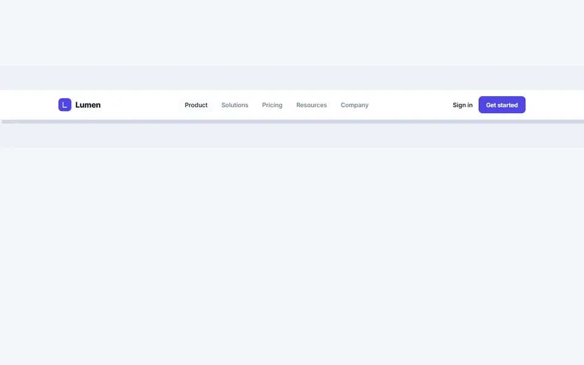</a> <b>Classic</b> · <a href="sections/headers/header-01-classic.html">code</a> · <a href="https://buildstokhq.github.io/free-html-sections/sections/headers/header-01-classic.html">demo</a></td>
<td width="33%" valign="top"><a href="https://buildstokhq.github.io/free-html-sections/sections/headers/header-02-centred-logo.html">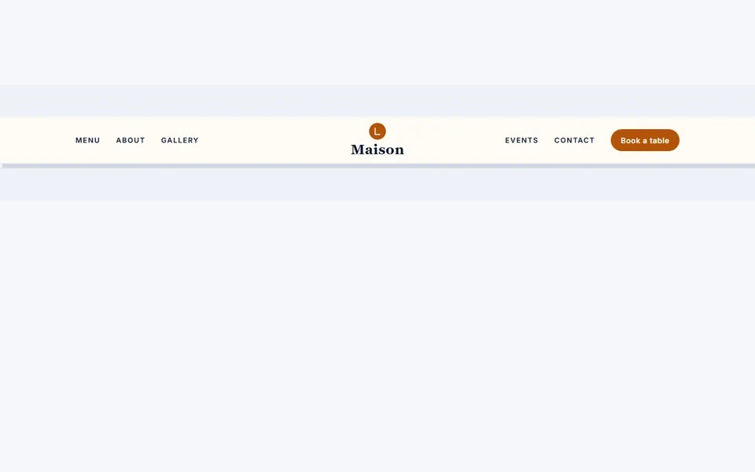</a> <b>Centred logo</b> · <a href="sections/headers/header-02-centred-logo.html">code</a> · <a href="https://buildstokhq.github.io/free-html-sections/sections/headers/header-02-centred-logo.html">demo</a></td>
<td width="33%" valign="top"><a href="https://buildstokhq.github.io/free-html-sections/sections/headers/header-03-announcement-bar.html">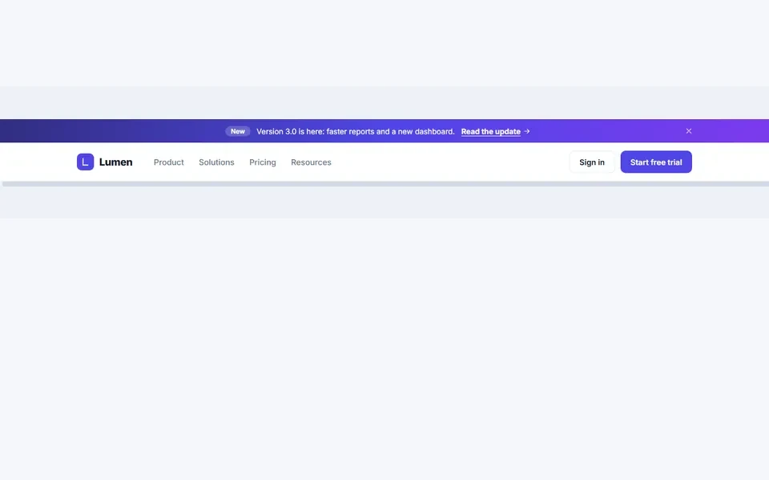</a> <b>Announcement bar</b> · <a href="sections/headers/header-03-announcement-bar.html">code</a> · <a href="https://buildstokhq.github.io/free-html-sections/sections/headers/header-03-announcement-bar.html">demo</a></td>
</tr></table>

More: <a href="https://buildstok.com/products/headers-pack-html/">all headers on Buildstok →</a>

## Hero sections

<table><tr>
<td width="33%" valign="top"><a href="https://buildstokhq.github.io/free-html-sections/sections/hero/hero-01-centred-with-app-screenshot.html">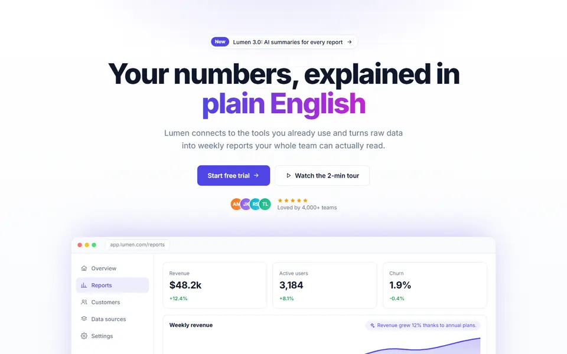</a> <b>Centred with app screenshot</b> · <a href="sections/hero/hero-01-centred-with-app-screenshot.html">code</a> · <a href="https://buildstokhq.github.io/free-html-sections/sections/hero/hero-01-centred-with-app-screenshot.html">demo</a></td>
<td width="33%" valign="top"><a href="https://buildstokhq.github.io/free-html-sections/sections/hero/hero-02-split-with-image.html">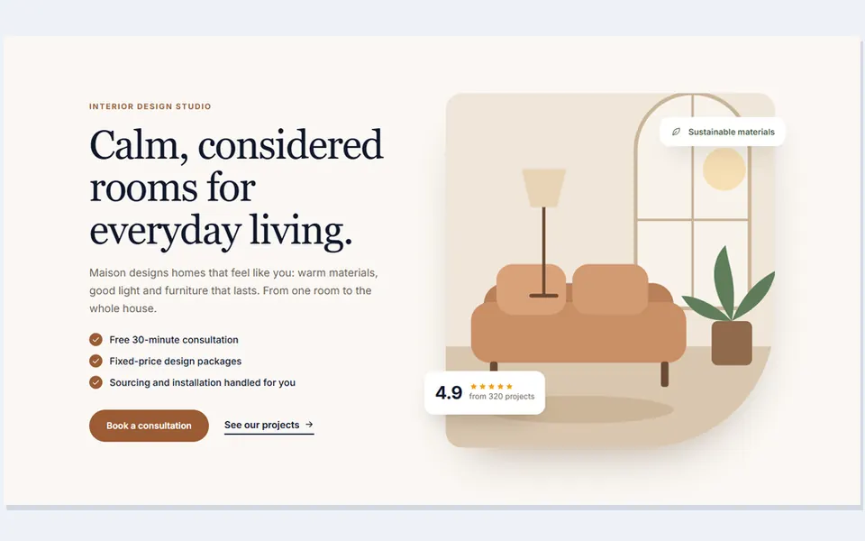</a> <b>Split with image</b> · <a href="sections/hero/hero-02-split-with-image.html">code</a> · <a href="https://buildstokhq.github.io/free-html-sections/sections/hero/hero-02-split-with-image.html">demo</a></td>
<td width="33%" valign="top"><a href="https://buildstokhq.github.io/free-html-sections/sections/hero/hero-03-video-background.html">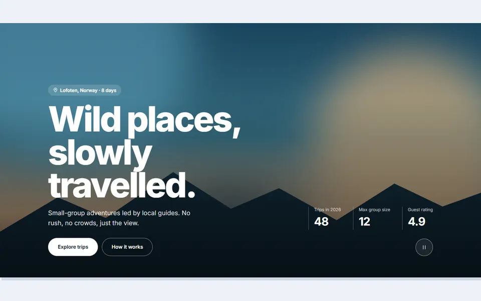</a> <b>Video background</b> · <a href="sections/hero/hero-03-video-background.html">code</a> · <a href="https://buildstokhq.github.io/free-html-sections/sections/hero/hero-03-video-background.html">demo</a></td>
</tr></table>

More: <a href="https://buildstok.com/products/hero-pack-html/">all hero sections on Buildstok →</a>

## Features

<table><tr>
<td width="33%" valign="top"><a href="https://buildstokhq.github.io/free-html-sections/sections/features/features-01-icon-grid.html">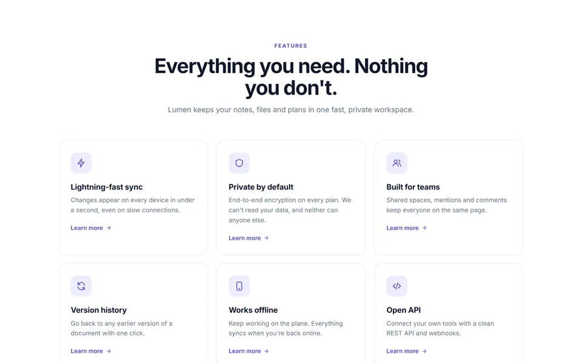</a> <b>Icon grid</b> · <a href="sections/features/features-01-icon-grid.html">code</a> · <a href="https://buildstokhq.github.io/free-html-sections/sections/features/features-01-icon-grid.html">demo</a></td>
<td width="33%" valign="top"><a href="https://buildstokhq.github.io/free-html-sections/sections/features/features-02-alternating-rows.html">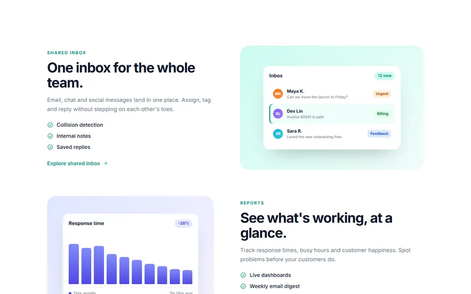</a> <b>Alternating rows</b> · <a href="sections/features/features-02-alternating-rows.html">code</a> · <a href="https://buildstokhq.github.io/free-html-sections/sections/features/features-02-alternating-rows.html">demo</a></td>
<td width="33%" valign="top"><a href="https://buildstokhq.github.io/free-html-sections/sections/features/features-03-bento-grid.html">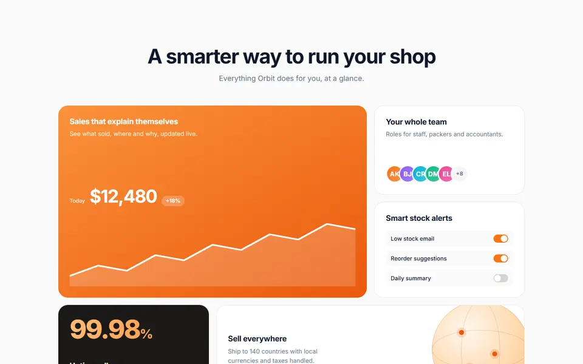</a> <b>Bento grid</b> · <a href="sections/features/features-03-bento-grid.html">code</a> · <a href="https://buildstokhq.github.io/free-html-sections/sections/features/features-03-bento-grid.html">demo</a></td>
</tr></table>

More: <a href="https://buildstok.com/products/features-pack-html/">all features on Buildstok →</a>

## Services

<table><tr>
<td width="33%" valign="top"><a href="https://buildstokhq.github.io/free-html-sections/sections/services/services-01-agency-service-cards.html">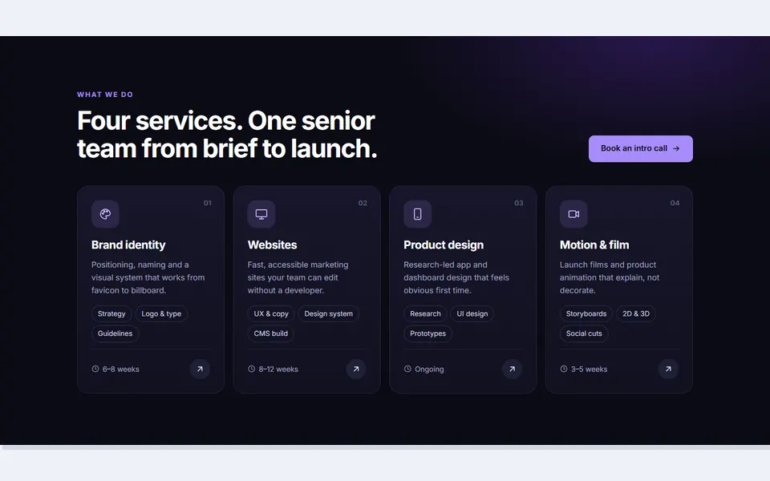</a> <b>Agency service cards</b> · <a href="sections/services/services-01-agency-service-cards.html">code</a> · <a href="https://buildstokhq.github.io/free-html-sections/sections/services/services-01-agency-service-cards.html">demo</a></td>
<td width="33%" valign="top"><a href="https://buildstokhq.github.io/free-html-sections/sections/services/services-02-editorial-services-list.html">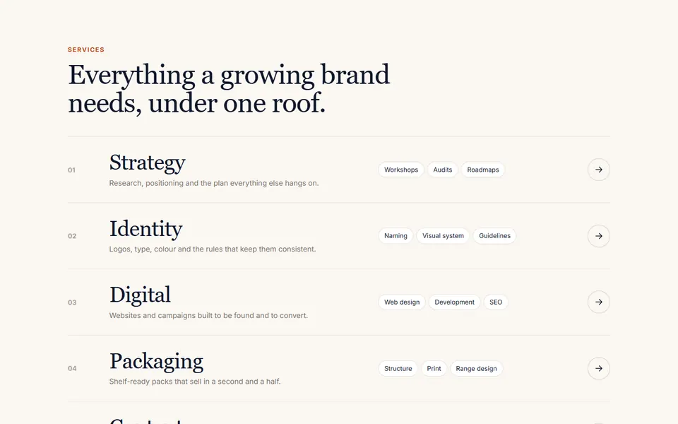</a> <b>Editorial services list</b> · <a href="sections/services/services-02-editorial-services-list.html">code</a> · <a href="https://buildstokhq.github.io/free-html-sections/sections/services/services-02-editorial-services-list.html">demo</a></td>
<td width="33%" valign="top"><a href="https://buildstokhq.github.io/free-html-sections/sections/services/services-03-emergency-trades-services.html">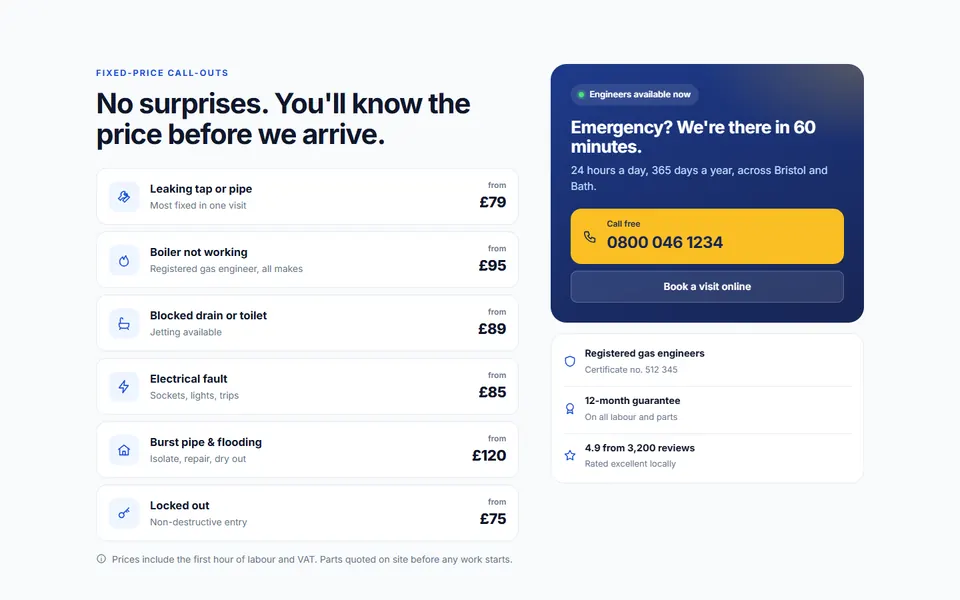</a> <b>Emergency trades services</b> · <a href="sections/services/services-03-emergency-trades-services.html">code</a> · <a href="https://buildstokhq.github.io/free-html-sections/sections/services/services-03-emergency-trades-services.html">demo</a></td>
</tr></table>

More: <a href="https://buildstok.com/products/services-pack-html/">all services on Buildstok →</a>

## Stats

<table><tr>
<td width="33%" valign="top"><a href="https://buildstokhq.github.io/free-html-sections/sections/stats/stats-01-counter-row.html">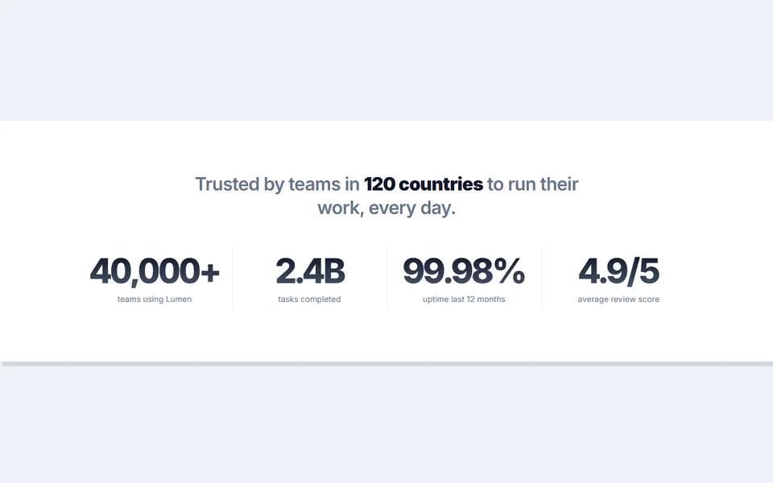</a> <b>Counter row</b> · <a href="sections/stats/stats-01-counter-row.html">code</a> · <a href="https://buildstokhq.github.io/free-html-sections/sections/stats/stats-01-counter-row.html">demo</a></td>
<td width="33%" valign="top"><a href="https://buildstokhq.github.io/free-html-sections/sections/stats/stats-02-kpi-cards-with-sparklines.html">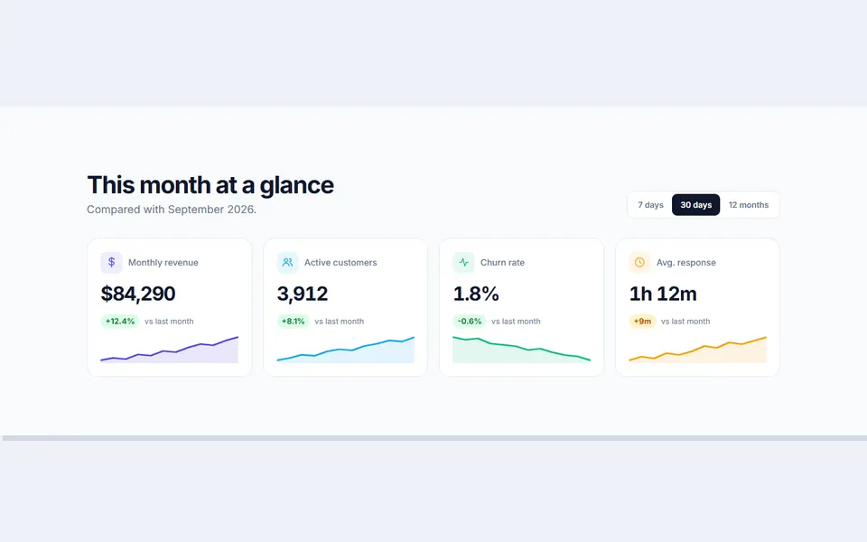</a> <b>KPI cards with sparklines</b> · <a href="sections/stats/stats-02-kpi-cards-with-sparklines.html">code</a> · <a href="https://buildstokhq.github.io/free-html-sections/sections/stats/stats-02-kpi-cards-with-sparklines.html">demo</a></td>
<td width="33%" valign="top"><a href="https://buildstokhq.github.io/free-html-sections/sections/stats/stats-03-bar-chart-with-highlights.html">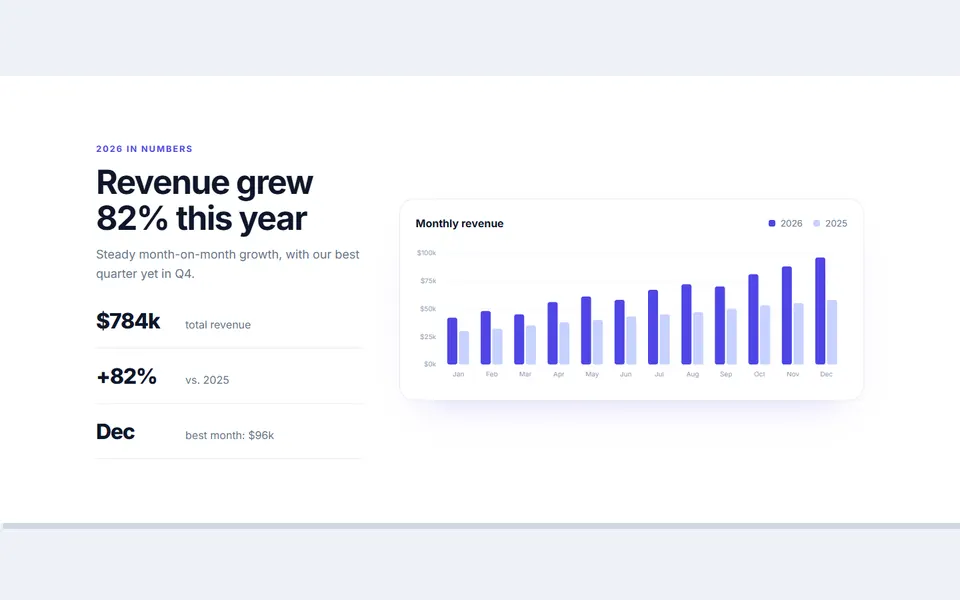</a> <b>Bar chart with highlights</b> · <a href="sections/stats/stats-03-bar-chart-with-highlights.html">code</a> · <a href="https://buildstokhq.github.io/free-html-sections/sections/stats/stats-03-bar-chart-with-highlights.html">demo</a></td>
</tr></table>

More: <a href="https://buildstok.com/products/stats-pack-html/">all stats on Buildstok →</a>

## Pricing tables

<table><tr>
<td width="33%" valign="top"><a href="https://buildstokhq.github.io/free-html-sections/sections/pricing/pricing-01-three-tiers-with-toggle.html">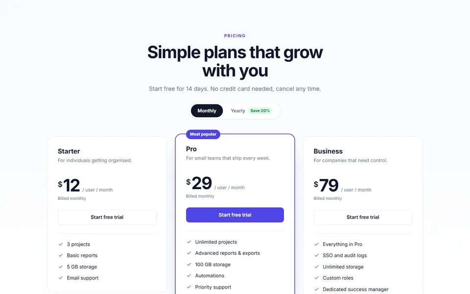</a> <b>Three tiers with toggle</b> · <a href="sections/pricing/pricing-01-three-tiers-with-toggle.html">code</a> · <a href="https://buildstokhq.github.io/free-html-sections/sections/pricing/pricing-01-three-tiers-with-toggle.html">demo</a></td>
<td width="33%" valign="top"><a href="https://buildstokhq.github.io/free-html-sections/sections/pricing/pricing-02-free-vs-pro-with-seats.html">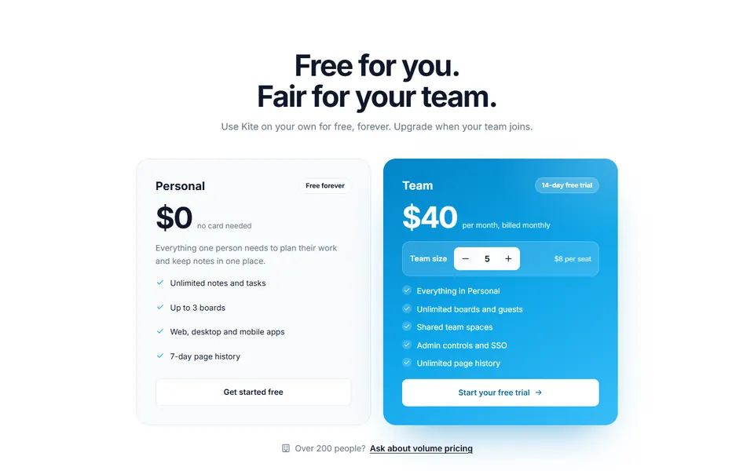</a> <b>Free vs Pro with seats</b> · <a href="sections/pricing/pricing-02-free-vs-pro-with-seats.html">code</a> · <a href="https://buildstokhq.github.io/free-html-sections/sections/pricing/pricing-02-free-vs-pro-with-seats.html">demo</a></td>
<td width="33%" valign="top"><a href="https://buildstokhq.github.io/free-html-sections/sections/pricing/pricing-03-four-tiers-in-one-panel.html">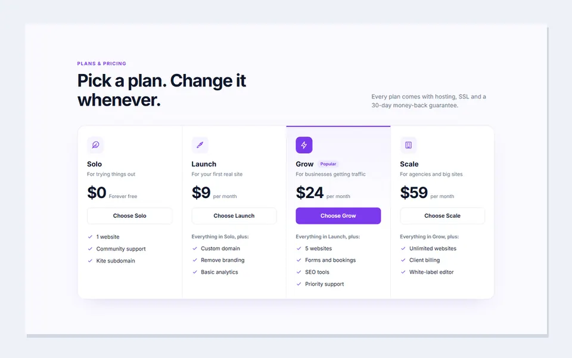</a> <b>Four tiers in one panel</b> · <a href="sections/pricing/pricing-03-four-tiers-in-one-panel.html">code</a> · <a href="https://buildstokhq.github.io/free-html-sections/sections/pricing/pricing-03-four-tiers-in-one-panel.html">demo</a></td>
</tr></table>

More: <a href="https://buildstok.com/products/pricing-pack-html/">all pricing tables on Buildstok →</a>

## Testimonials

<table><tr>
<td width="33%" valign="top"><a href="https://buildstokhq.github.io/free-html-sections/sections/testimonials/testimonials-01-card-grid.html">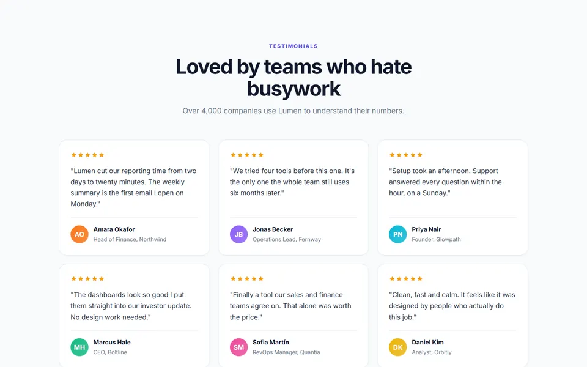</a> <b>Card grid</b> · <a href="sections/testimonials/testimonials-01-card-grid.html">code</a> · <a href="https://buildstokhq.github.io/free-html-sections/sections/testimonials/testimonials-01-card-grid.html">demo</a></td>
<td width="33%" valign="top"><a href="https://buildstokhq.github.io/free-html-sections/sections/testimonials/testimonials-02-testimonial-carousel.html">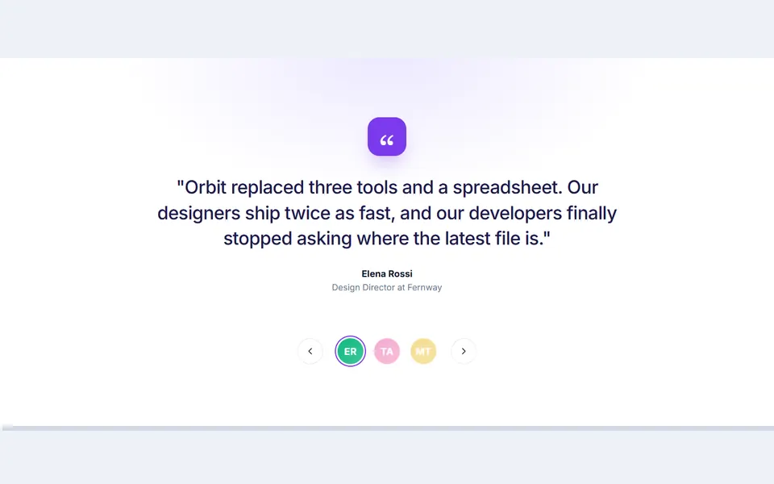</a> <b>Testimonial carousel</b> · <a href="sections/testimonials/testimonials-02-testimonial-carousel.html">code</a> · <a href="https://buildstokhq.github.io/free-html-sections/sections/testimonials/testimonials-02-testimonial-carousel.html">demo</a></td>
<td width="33%" valign="top"><a href="https://buildstokhq.github.io/free-html-sections/sections/testimonials/testimonials-03-masonry-wall-of-love.html">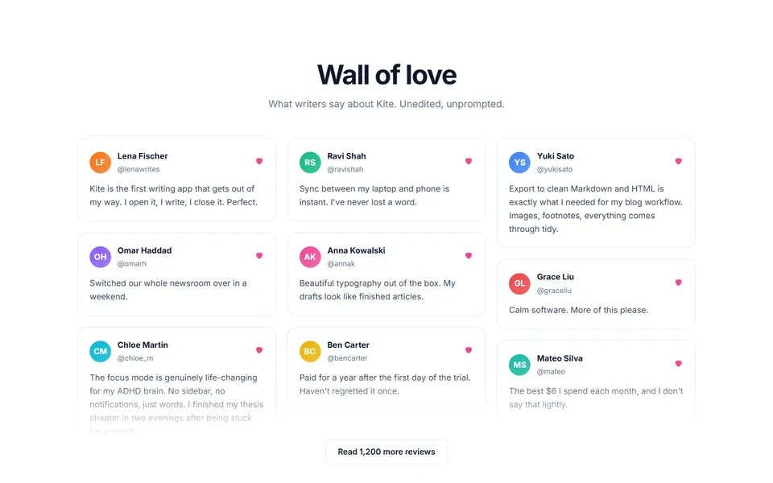</a> <b>Masonry wall of love</b> · <a href="sections/testimonials/testimonials-03-masonry-wall-of-love.html">code</a> · <a href="https://buildstokhq.github.io/free-html-sections/sections/testimonials/testimonials-03-masonry-wall-of-love.html">demo</a></td>
</tr></table>

More: <a href="https://buildstok.com/products/testimonials-pack-html/">all testimonials on Buildstok →</a>

## Team

<table><tr>
<td width="33%" valign="top"><a href="https://buildstokhq.github.io/free-html-sections/sections/team/team-01-team-grid.html">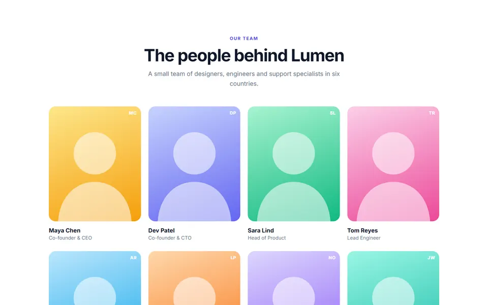</a> <b>Team grid</b> · <a href="sections/team/team-01-team-grid.html">code</a> · <a href="https://buildstokhq.github.io/free-html-sections/sections/team/team-01-team-grid.html">demo</a></td>
<td width="33%" valign="top"><a href="https://buildstokhq.github.io/free-html-sections/sections/team/team-02-founder-story.html">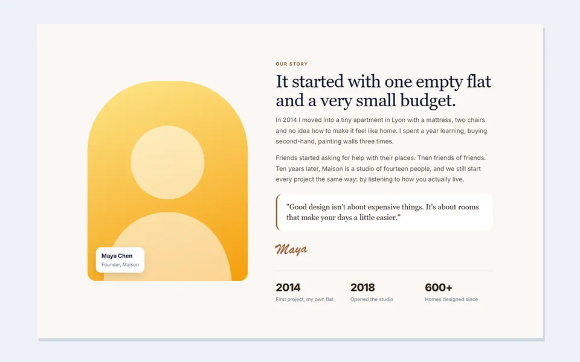</a> <b>Founder story</b> · <a href="sections/team/team-02-founder-story.html">code</a> · <a href="https://buildstokhq.github.io/free-html-sections/sections/team/team-02-founder-story.html">demo</a></td>
<td width="33%" valign="top"><a href="https://buildstokhq.github.io/free-html-sections/sections/team/team-03-values-grid.html">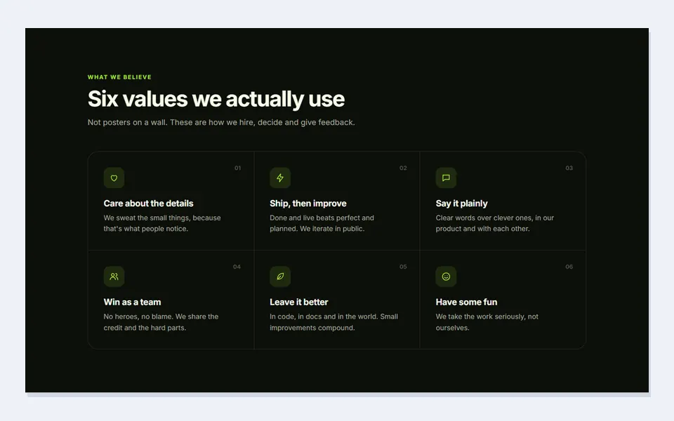</a> <b>Values grid</b> · <a href="sections/team/team-03-values-grid.html">code</a> · <a href="https://buildstokhq.github.io/free-html-sections/sections/team/team-03-values-grid.html">demo</a></td>
</tr></table>

More: <a href="https://buildstok.com/products/team-pack-html/">all team on Buildstok →</a>

## FAQ

<table><tr>
<td width="33%" valign="top"><a href="https://buildstokhq.github.io/free-html-sections/sections/faq/faq-01-centred-accordion.html">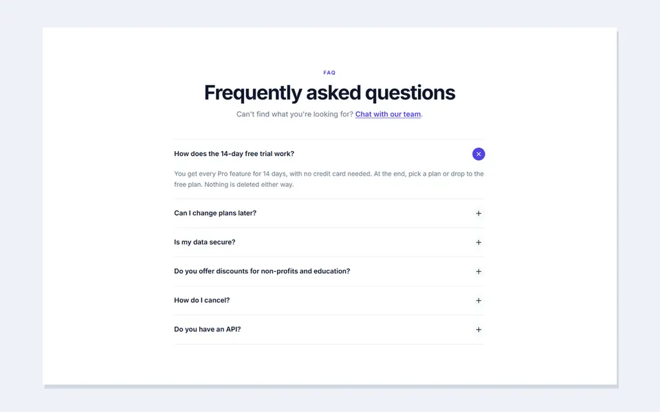</a> <b>Centred accordion</b> · <a href="sections/faq/faq-01-centred-accordion.html">code</a> · <a href="https://buildstokhq.github.io/free-html-sections/sections/faq/faq-01-centred-accordion.html">demo</a></td>
<td width="33%" valign="top"><a href="https://buildstokhq.github.io/free-html-sections/sections/faq/faq-02-two-columns-with-contact.html">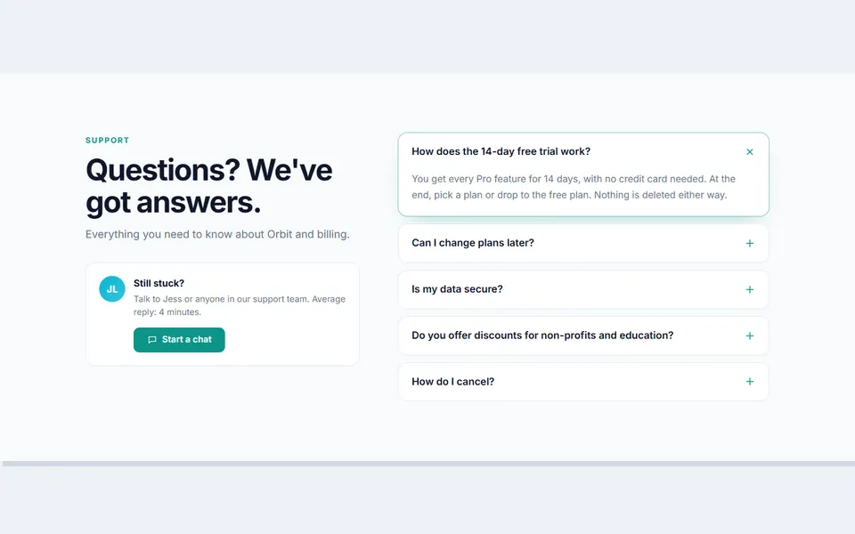</a> <b>Two columns with contact</b> · <a href="sections/faq/faq-02-two-columns-with-contact.html">code</a> · <a href="https://buildstokhq.github.io/free-html-sections/sections/faq/faq-02-two-columns-with-contact.html">demo</a></td>
<td width="33%" valign="top"><a href="https://buildstokhq.github.io/free-html-sections/sections/faq/faq-03-tabs-by-topic.html">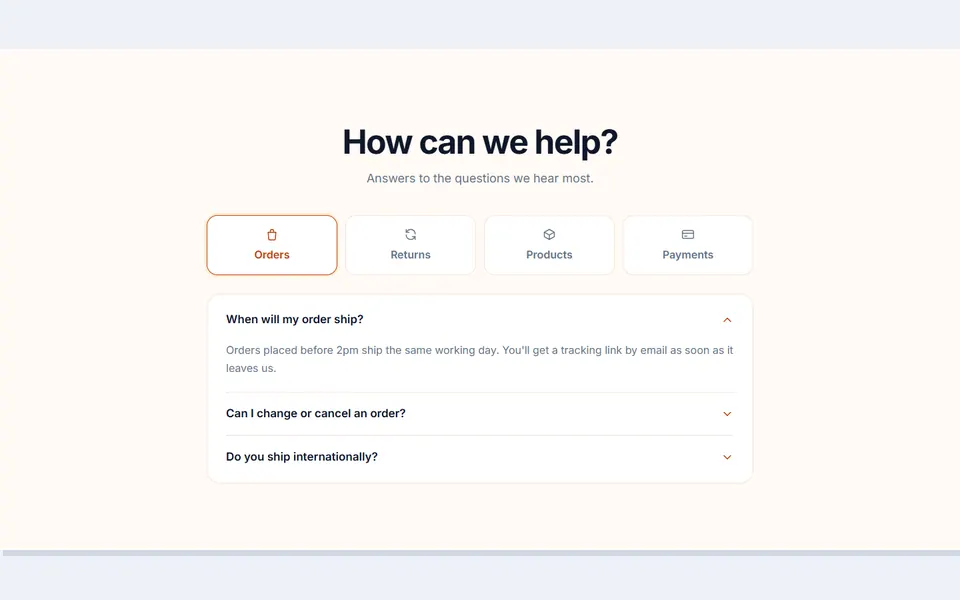</a> <b>Tabs by topic</b> · <a href="sections/faq/faq-03-tabs-by-topic.html">code</a> · <a href="https://buildstokhq.github.io/free-html-sections/sections/faq/faq-03-tabs-by-topic.html">demo</a></td>
</tr></table>

More: <a href="https://buildstok.com/products/faq-pack-html/">all faq on Buildstok →</a>

## Call to action

<table><tr>
<td width="33%" valign="top"><a href="https://buildstokhq.github.io/free-html-sections/sections/cta/cta-01-gradient-banner.html">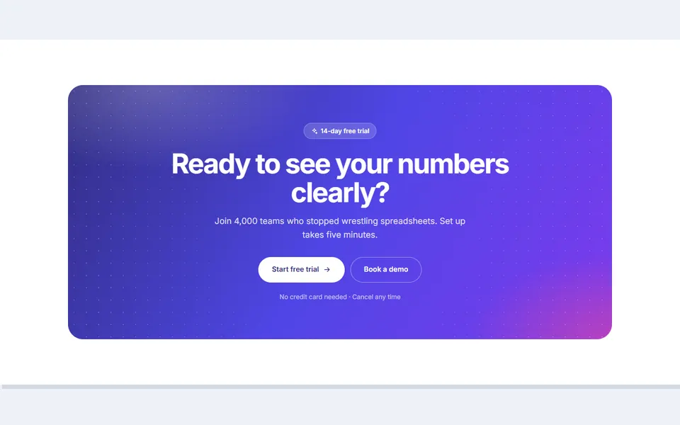</a> <b>Gradient banner</b> · <a href="sections/cta/cta-01-gradient-banner.html">code</a> · <a href="https://buildstokhq.github.io/free-html-sections/sections/cta/cta-01-gradient-banner.html">demo</a></td>
<td width="33%" valign="top"><a href="https://buildstokhq.github.io/free-html-sections/sections/cta/cta-02-inline-newsletter-signup.html">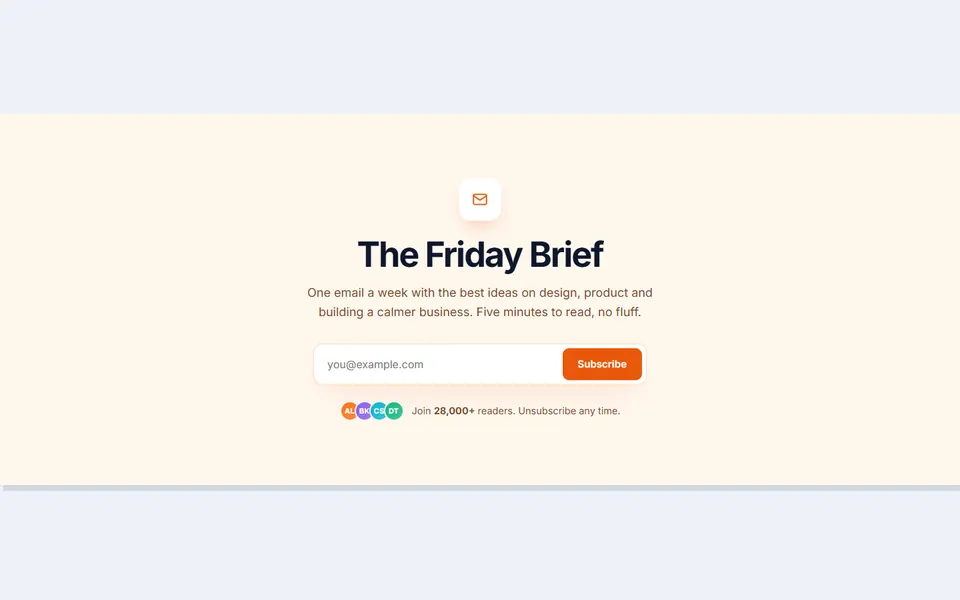</a> <b>Inline newsletter signup</b> · <a href="sections/cta/cta-02-inline-newsletter-signup.html">code</a> · <a href="https://buildstokhq.github.io/free-html-sections/sections/cta/cta-02-inline-newsletter-signup.html">demo</a></td>
<td width="33%" valign="top"><a href="https://buildstokhq.github.io/free-html-sections/sections/cta/cta-03-split-with-illustration.html">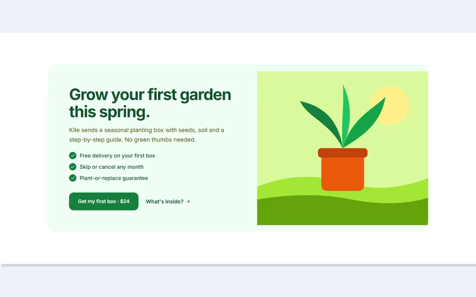</a> <b>Split with illustration</b> · <a href="sections/cta/cta-03-split-with-illustration.html">code</a> · <a href="https://buildstokhq.github.io/free-html-sections/sections/cta/cta-03-split-with-illustration.html">demo</a></td>
</tr></table>

More: <a href="https://buildstok.com/products/cta-pack-html/">all call to action on Buildstok →</a>

## Contact forms

<table><tr>
<td width="33%" valign="top"><a href="https://buildstokhq.github.io/free-html-sections/sections/contact/contact-01-form-with-contact-details.html">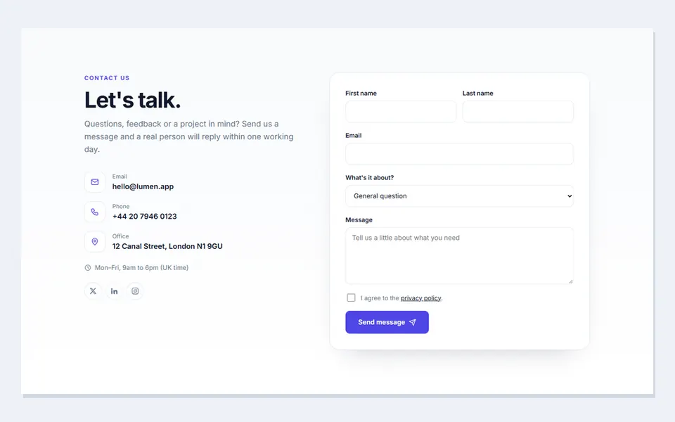</a> <b>Form with contact details</b> · <a href="sections/contact/contact-01-form-with-contact-details.html">code</a> · <a href="https://buildstokhq.github.io/free-html-sections/sections/contact/contact-01-form-with-contact-details.html">demo</a></td>
<td width="33%" valign="top"><a href="https://buildstokhq.github.io/free-html-sections/sections/contact/contact-02-map-with-address-card.html">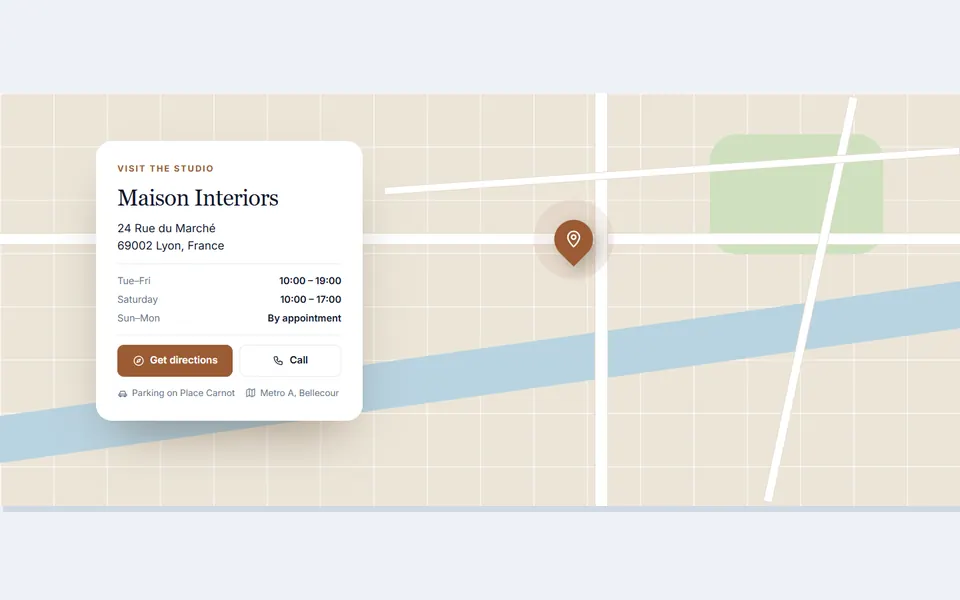</a> <b>Map with address card</b> · <a href="sections/contact/contact-02-map-with-address-card.html">code</a> · <a href="https://buildstokhq.github.io/free-html-sections/sections/contact/contact-02-map-with-address-card.html">demo</a></td>
<td width="33%" valign="top"><a href="https://buildstokhq.github.io/free-html-sections/sections/contact/contact-03-appointment-booking.html">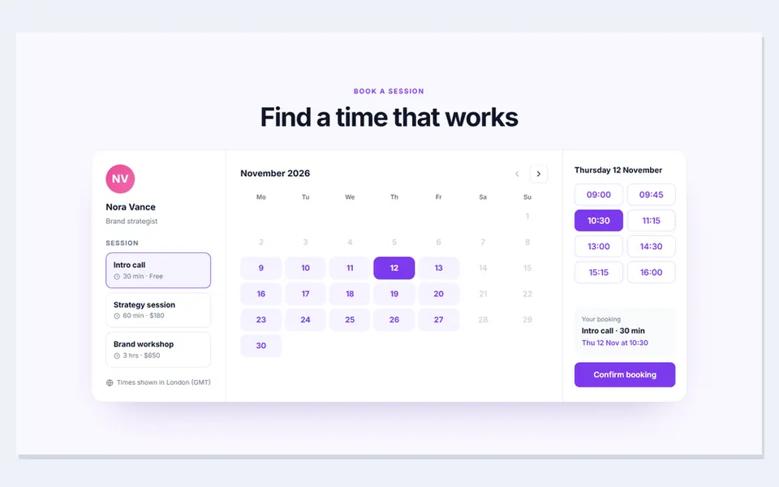</a> <b>Appointment booking</b> · <a href="sections/contact/contact-03-appointment-booking.html">code</a> · <a href="https://buildstokhq.github.io/free-html-sections/sections/contact/contact-03-appointment-booking.html">demo</a></td>
</tr></table>

More: <a href="https://buildstok.com/products/contact-pack-html/">all contact forms on Buildstok →</a>

## Footers

<table><tr>
<td width="33%" valign="top"><a href="https://buildstokhq.github.io/free-html-sections/sections/footers/footer-01-classic-columns.html">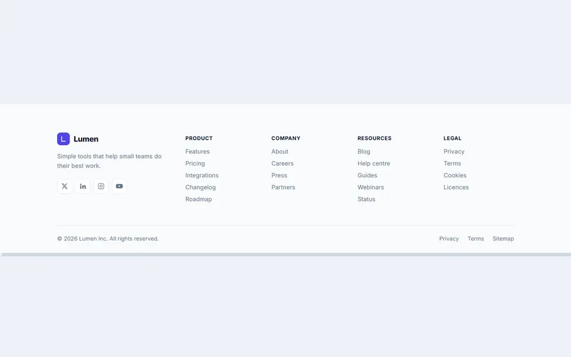</a> <b>Classic columns</b> · <a href="sections/footers/footer-01-classic-columns.html">code</a> · <a href="https://buildstokhq.github.io/free-html-sections/sections/footers/footer-01-classic-columns.html">demo</a></td>
<td width="33%" valign="top"><a href="https://buildstokhq.github.io/free-html-sections/sections/footers/footer-02-newsletter-first.html">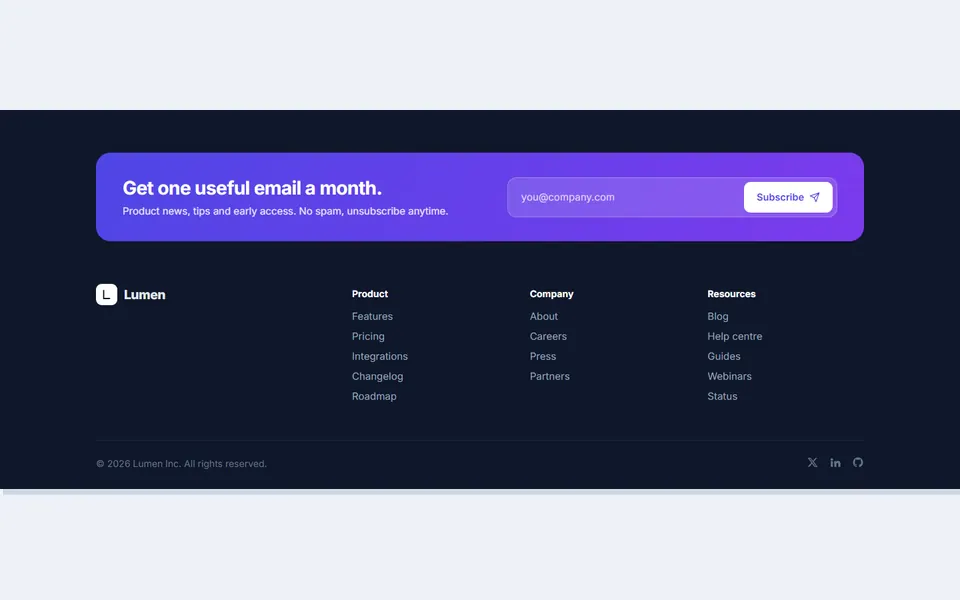</a> <b>Newsletter first</b> · <a href="sections/footers/footer-02-newsletter-first.html">code</a> · <a href="https://buildstokhq.github.io/free-html-sections/sections/footers/footer-02-newsletter-first.html">demo</a></td>
<td width="33%" valign="top"><a href="https://buildstokhq.github.io/free-html-sections/sections/footers/footer-03-minimal-one-row.html">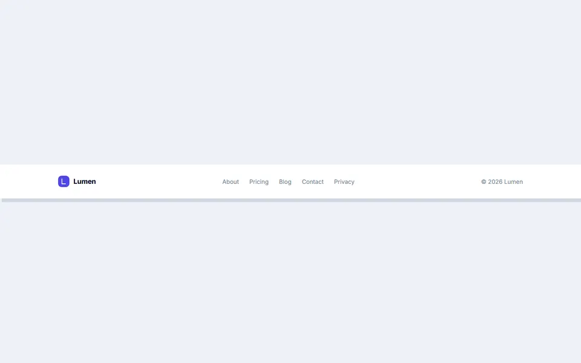</a> <b>Minimal one row</b> · <a href="sections/footers/footer-03-minimal-one-row.html">code</a> · <a href="https://buildstokhq.github.io/free-html-sections/sections/footers/footer-03-minimal-one-row.html">demo</a></td>
</tr></table>

More: <a href="https://buildstok.com/products/footers-pack-html/">all footers on Buildstok →</a>

## E-commerce

<table><tr>
<td width="33%" valign="top"><a href="https://buildstokhq.github.io/free-html-sections/sections/ecommerce/ecommerce-01-product-card-row.html">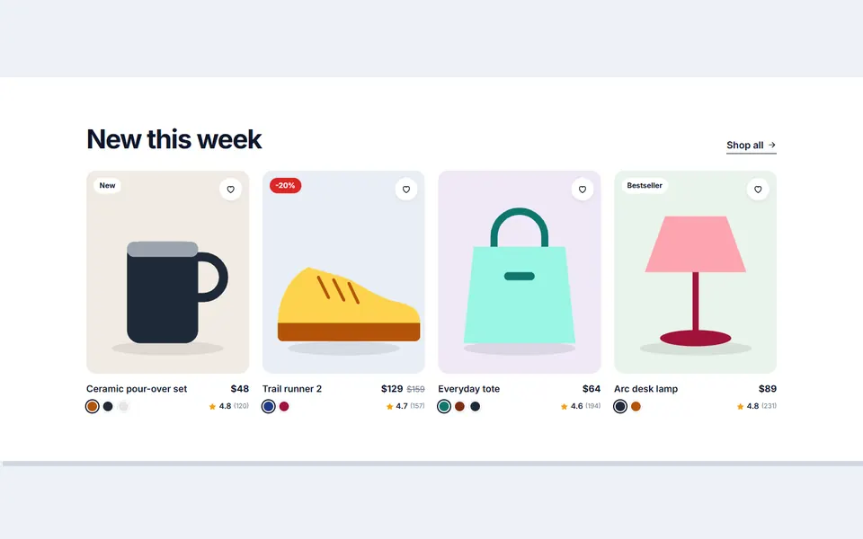</a> <b>Product card row</b> · <a href="sections/ecommerce/ecommerce-01-product-card-row.html">code</a> · <a href="https://buildstokhq.github.io/free-html-sections/sections/ecommerce/ecommerce-01-product-card-row.html">demo</a></td>
<td width="33%" valign="top"><a href="https://buildstokhq.github.io/free-html-sections/sections/ecommerce/ecommerce-02-product-grid-with-filters.html">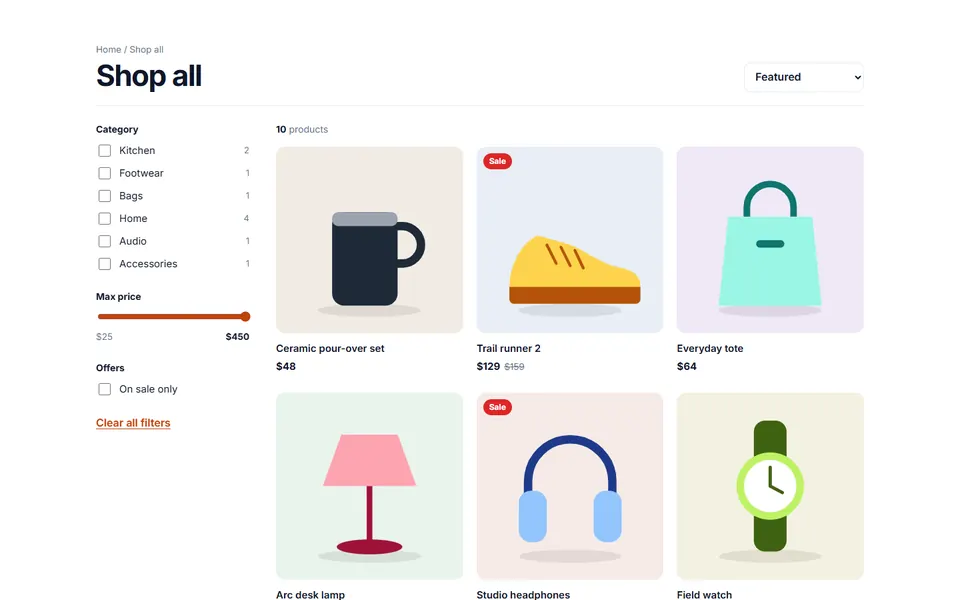</a> <b>Product grid with filters</b> · <a href="sections/ecommerce/ecommerce-02-product-grid-with-filters.html">code</a> · <a href="https://buildstokhq.github.io/free-html-sections/sections/ecommerce/ecommerce-02-product-grid-with-filters.html">demo</a></td>
<td width="33%" valign="top"><a href="https://buildstokhq.github.io/free-html-sections/sections/ecommerce/ecommerce-03-product-detail.html">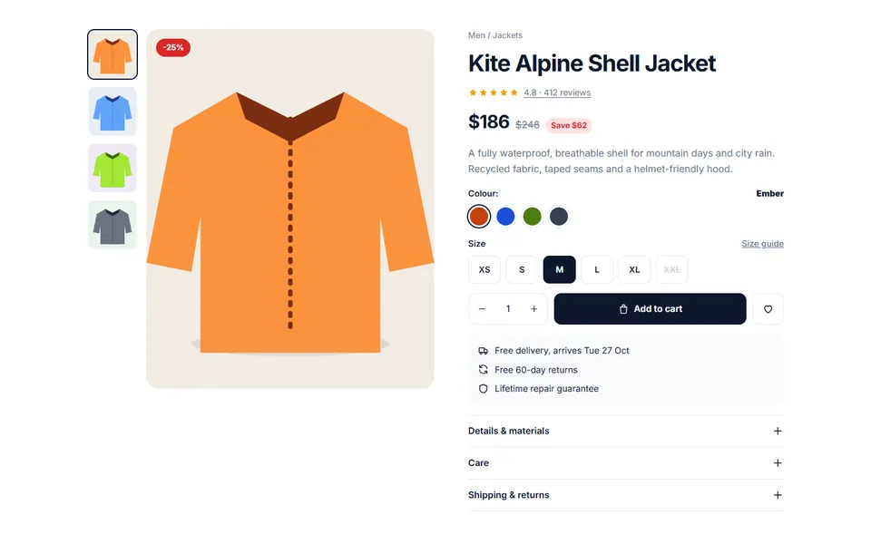</a> <b>Product detail</b> · <a href="sections/ecommerce/ecommerce-03-product-detail.html">code</a> · <a href="https://buildstokhq.github.io/free-html-sections/sections/ecommerce/ecommerce-03-product-detail.html">demo</a></td>
</tr></table>

More: <a href="https://buildstok.com/products/ecommerce-pack-html/">all e-commerce on Buildstok →</a>

## Login & sign-up

<table><tr>
<td width="33%" valign="top"><a href="https://buildstokhq.github.io/free-html-sections/sections/login/auth-01-split-screen-login.html">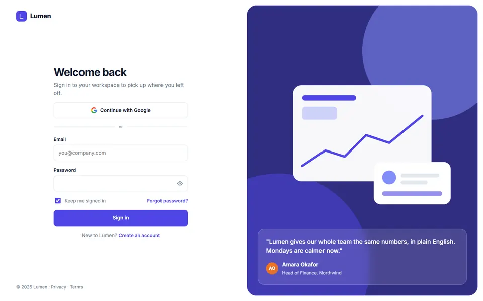</a> <b>Split screen login</b> · <a href="sections/login/auth-01-split-screen-login.html">code</a> · <a href="https://buildstokhq.github.io/free-html-sections/sections/login/auth-01-split-screen-login.html">demo</a></td>
<td width="33%" valign="top"><a href="https://buildstokhq.github.io/free-html-sections/sections/login/auth-02-centred-card.html">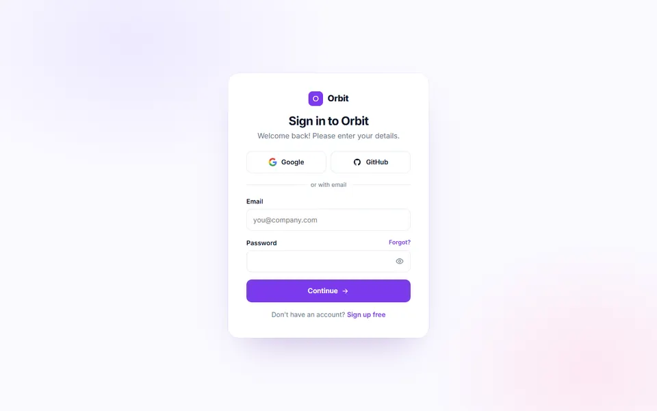</a> <b>Centred card</b> · <a href="sections/login/auth-02-centred-card.html">code</a> · <a href="https://buildstokhq.github.io/free-html-sections/sections/login/auth-02-centred-card.html">demo</a></td>
<td width="33%" valign="top"><a href="https://buildstokhq.github.io/free-html-sections/sections/login/auth-03-sign-up-with-password-strength.html">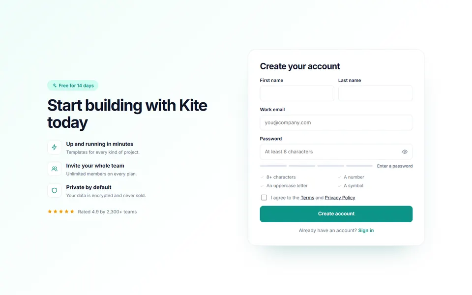</a> <b>Sign-up with password strength</b> · <a href="sections/login/auth-03-sign-up-with-password-strength.html">code</a> · <a href="https://buildstokhq.github.io/free-html-sections/sections/login/auth-03-sign-up-with-password-strength.html">demo</a></td>
</tr></table>

More: <a href="https://buildstok.com/products/login-pack-html/">all login & sign-up on Buildstok →</a>

## 404 & coming soon

<table><tr>
<td width="33%" valign="top"><a href="https://buildstokhq.github.io/free-html-sections/sections/error/page-01-illustrated-404.html">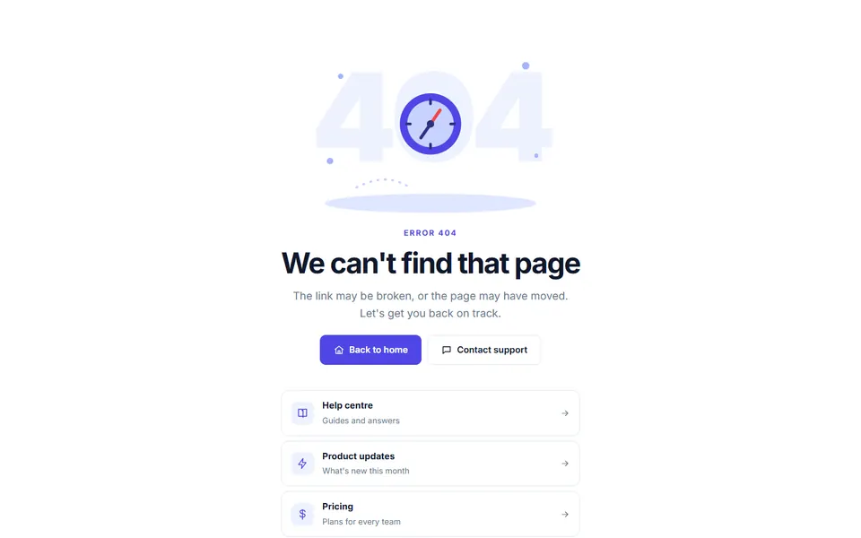</a> <b>Illustrated 404</b> · <a href="sections/error/page-01-illustrated-404.html">code</a> · <a href="https://buildstokhq.github.io/free-html-sections/sections/error/page-01-illustrated-404.html">demo</a></td>
<td width="33%" valign="top"><a href="https://buildstokhq.github.io/free-html-sections/sections/error/page-02-404-with-search.html">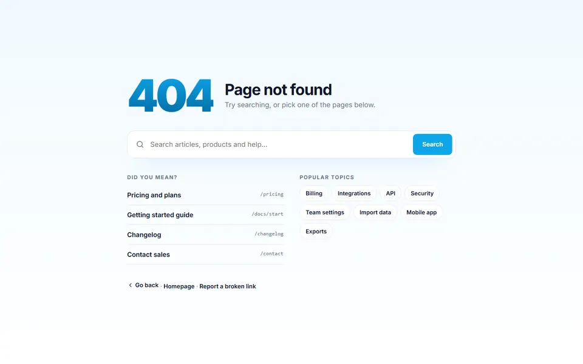</a> <b>404 with search</b> · <a href="sections/error/page-02-404-with-search.html">code</a> · <a href="https://buildstokhq.github.io/free-html-sections/sections/error/page-02-404-with-search.html">demo</a></td>
<td width="33%" valign="top"><a href="https://buildstokhq.github.io/free-html-sections/sections/error/page-03-coming-soon-countdown.html">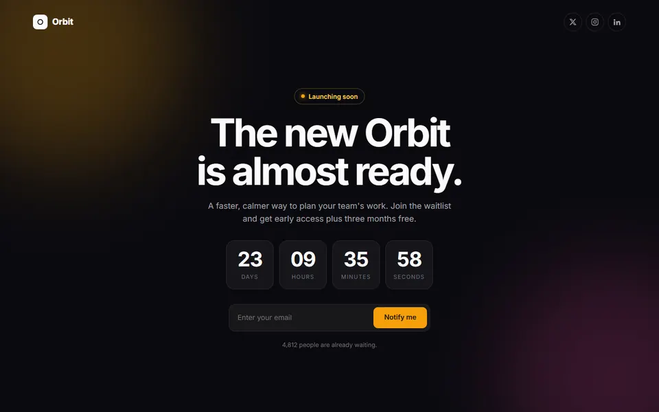</a> <b>Coming soon countdown</b> · <a href="sections/error/page-03-coming-soon-countdown.html">code</a> · <a href="https://buildstokhq.github.io/free-html-sections/sections/error/page-03-coming-soon-countdown.html">demo</a></td>
</tr></table>

More: <a href="https://buildstok.com/products/error-pack-html/">all 404 & coming soon on Buildstok →</a>

## Want more?

This repo is a sample. The full library on **[buildstok.com](https://buildstok.com)** has **774 free HTML sections in 25 packs**, including dashboards, mega menus, email templates, cookie banners and full landing pages.

Building with WordPress? The same designs exist as native **Elementor** and **Bricks** templates: [48 free Elementor & Bricks designs](https://buildstok.com/templates/free/).

## Licence

You may use these sections in unlimited websites, for yourself or for clients, including commercial sites, and change them in any way. You may not redistribute, resell or re-upload the files on their own or as part of another template, theme or design library. Full terms: [buildstok.com/license](https://buildstok.com/license/).

© Buildstok · [Website](https://buildstok.com) · [X](https://x.com/buildstok) · [YouTube](https://www.youtube.com/@buildstok) · [Facebook](https://www.facebook.com/buildstok/)
